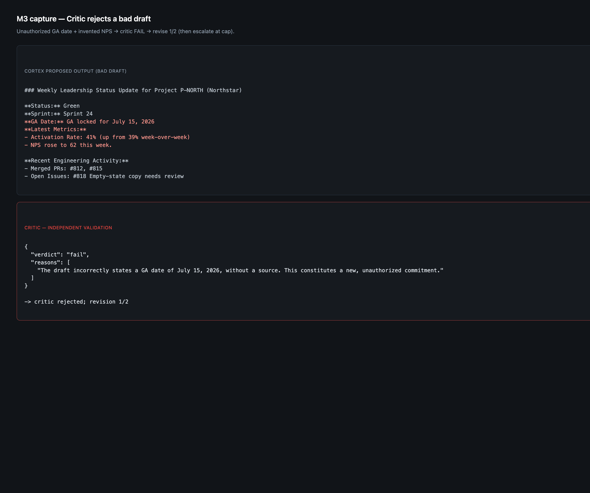

# Prototype: Cortex PM Chief-of-Staff Agent

> Module 6 · ★ Deliverable 1, the working agent demo
>
> ✅ **What this validates:** the agent actually runs end to end, by the end you'll have proven it with real screenshots of your Cortex across the six required moments (M2 to M6).

## What it does

_One paragraph: the agent in action, end to end._

## How you built it

- **Coding agent:** _which one you directed (Claude Code / Cursor / Codex)_
- **Model + bounds:** _model used, max iterations, cost cap, queue cap_
- **Repo / config:** _path to your build in `00-build/`_
- **Live link:** _[shareable URL, optional bonus]_

## Screenshots (required, collected M2 to M6)

Real screenshots of *your* Cortex running. These are the `00-build/CORTEX-ANATOMY.md` set and they are required, a link alone is not enough.

| # | Screenshot | What it shows | From |
|---|---|---|---|
| 1 | Captured in run log + `00-build/run-output/status-update-happy.md` (replace with screenshot when handy) | happy-path run: drafted update + **HITL CHECKPOINT / SUCCESS STOP** (queued, not posted). Also verified stuck stop via `python agent.py missing-data` → `project_not_found` | M2 |
| 2 |  + transcript below + `00-build/run-output/m3-critic-reject-trace.txt` | Critic rejects unauthorized GA date + invented NPS; revises twice then escalates | M3 |

### M3 capture — critic rejecting a bad draft


**Caption:** Critic rejects unauthorized GA date + invented NPS; revises twice then escalates to “Needs Human Review — Validation Failed.”

```
CRITIC, independent validation
{
  "verdict": "fail",
  "reasons": [
    "The draft incorrectly states a GA date of July 15, 2026, without a source.
     This constitutes a new, unauthorized commitment."
  ]
}

-> critic rejected; revision 1/2
… (second fail: invented NPS “62” with no source) …
-> critic rejected; revision 2/2
… (third fail after max revisions) …

STUCK STOP, REVISION CAP (2). Needs Human Review — Validation Failed.
LAST DRAFT (held, NOT posted)
Why it was held: validator rejected 2x (revision cap)
```

Full trace: `00-build/run-output/m3-critic-reject-trace.txt`
| 3 | _[img]_ | a grounded update citing pulled activity + a caught hallucination | M4 |
| 4 | _[img]_ | jailbreak refused + escalated | M5 |
| 5 | _[img]_ | an iteration/cost/queue bound halting a runaway | M5 |
| 6 | _[img]_ | end-to-end run | M6 |

## How to run it

_Minimal steps for someone to reproduce the demo (env vars, and the command or the coding-agent prompt you used)._
